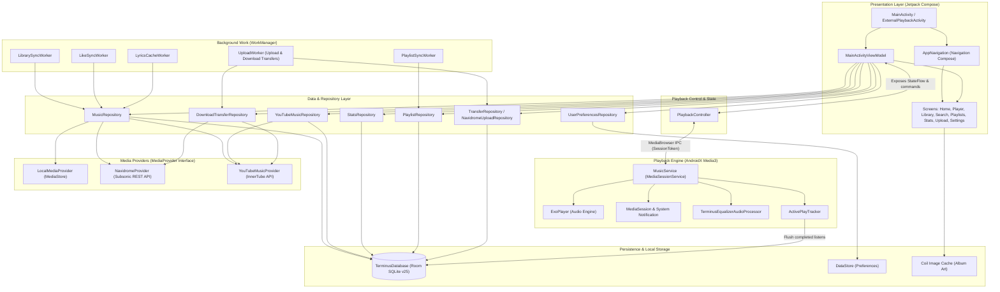

# Terminus System Architecture

This document describes the high-level architecture, layer responsibilities, and data flows of the **Terminus** Android music application.

---

## 1. Architectural Overview

Terminus is built with modern Android architectural best practices:
- **Clean Architecture & Separation of Concerns**: Isolates UI, playback services, data providers, and persistence.
- **Unidirectional Data Flow (UDF)**: UI observes reactive state (`StateFlow`) and emits explicit user intents or actions.
- **Provider Abstraction**: Decouples the application from concrete storage backends via the `MediaProvider` interface, supporting local device media (`LocalMediaProvider`), remote Subsonic/Navidrome servers (`NavidromeProvider`), YouTube Music streaming and search (`YouTubeMusicProvider`), and Creative Commons Jamendo audio.
- **Foreground Media Service**: Offloads audio decoding, audio focus, notification management, and media session synchronization to a dedicated AndroidX Media3 `MediaSessionService`.



---

## 2. Core Layers & Responsibilities

### Presentation Layer (`ui`)
- **Technology**: Jetpack Compose, Jetpack Navigation Compose, Material 3 + Custom HUD/CRT Design System.
- **Key Components**:
  - `MainActivity`: Single-activity container hosting the Compose UI tree and system bar configuration.
  - `ExternalPlaybackActivity`: Lightweight endpoint to handle external `ACTION_VIEW` audio intents.
  - `MainActivityViewModel`: Collects repositories, combines audio playback status, and exposes immutable UI state to composables.
  - `screens/`: Feature-scoped screen composables (`HomeScreen`, `NowPlayingScreen`, `LibraryScreen`, `SearchScreen`, `StatsScreen`, `UploadScreen`, `SettingsScreen`, etc.).

### Playback Layer (`playback`)
- **Technology**: AndroidX Media3 (ExoPlayer), Android MediaSession, AudioFocus.
- **Key Components**:
  - `MusicService`: Runs as a bound/foreground `MediaSessionService`. Manages the `ExoPlayer` instance, media notifications, lockscreen playback controls, audio focus loss/ducking, and crossfading.
  - `PlaybackController`: Singleton controller injected into UI ViewModels. Communicates with `MusicService` via AndroidX `MediaController` across process/thread boundaries. Exposes observable `nowPlaying: StateFlow<NowPlayingState>`.
  - `ActivePlayTracker`: Granular listening session timer that tracks elapsed milliseconds and flushes play events to `StatsRepository` when qualification thresholds are met.
  - `TerminusEqualizerAudioProcessor`: 5-band biquad DSP equalizer AudioProcessor positioned in the ExoPlayer AudioSink chain.

### Data & Provider Layer (`data`)
- **Key Components**:
  - `MediaProvider`: Unified contract defining operations for loading tracks, albums, artists, playlists, search, streaming URLs, download formats, and stream cache invalidation.
  - `LocalMediaProvider`: Queries Android's system `MediaStore` for local audio files.
  - `NavidromeProvider`: Communicates with a personal Navidrome server using the Subsonic API standard (REST/XML/JSON), parsing remote metadata, search results, and stream tokens.
  - `YouTubeMusicProvider`: Integrates with YouTube Music / InnerTube for search, paged browsing, dynamic explore categories/chips, lyrics, and stream resolution.
  - `YouTubeInnerTubeClient`: Raw HTTP client connecting to YouTube Music (`music.youtube.com/youtubei/v1`) using the `WEB_REMIX` client for browse/search/lyrics and the `VISIONOS` client for direct adaptive audio stream formats without signature ciphers.
  - `YouTubeStreamResolver`: Selects adaptive audio formats constrained by user bitrate ceilings with conservative 5-hour format caching, in-flight deduplication, and cache invalidation on 403/410 expiration.
  - `MusicRepository`: Central facade orchestrating local database operations, multi-provider stream resolution, offline download verification, and favorites/playlist synchronization.
  - `YouTubeMusicRepository`: Specialized repository for YouTube search paging, search suggestions, discovery filters, and on-demand Room track persistence.
  - `DownloadTransferRepository`: Interface contract defining resilient track downloads with progress reporting, quality ceiling enforcement, and partial file cleanup.
  - `UserPreferencesRepository`: Backed by AndroidX DataStore for user settings (theme overrides, motion modes, crossfade duration, equalizer presets, Navidrome server credentials, cellular bitrates, and download quality ceilings).

### Background Execution (`sync`)
- **Technology**: AndroidX WorkManager, Foreground Services.
- **Key Components**:
  - `LibrarySyncWorker`: Performs periodic or on-demand catalog synchronizations with configured providers. Remote-only providers (`youtube`, `jamendo`) are preserved across catalog purges.
  - `UploadWorker`: Handles queue-based bi-directional file transfers (uploading local audio to Navidrome, downloading server and YouTube streams for offline listening) with foreground notifications.
  - `LikeSyncWorker` & `PlaylistSyncWorker`: Syncs favorite tracks and playlist structures with remote servers.
  - `LyricsCacheWorker`: Fetches and caches synchronized LRC lyrics.

---

## 3. Music Provider Architecture

Terminus implements a multi-source provider pattern where all sources conform to the [MediaProvider](file:///home/amns/Projects/Terminus/app/src/main/java/com/necroware/terminusplayer/data/provider/MediaProvider.kt) interface.

### Active Providers & Responsibilities

| Provider ID | Implementation Class | Primary Source | Supported Operations |
| :--- | :--- | :--- | :--- |
| **`local`** | `LocalMediaProvider` | Android `MediaStore` | Catalog scan, local audio playback, upload to Navidrome. |
| **`navidrome`** | `NavidromeProvider` | Subsonic / Navidrome REST API | Catalog scan, server streaming, star/favorite sync, playlist sync, offline download, upload target. |
| **`youtube`** | `YouTubeMusicProvider` | YouTube InnerTube API | Paged search, search suggestions, mood/genre exploration, direct audio streaming, offline download, lyrics extraction. |
| **`jamendo`** | Server-backed (CC) | Jamendo CDN | Direct streaming, duration unit mapping, local favorites. |

### Canonical Track Identity

Track identities across Terminus are namespaced to guarantee uniqueness across providers and offline storage:
$$\text{remoteId} = \text{providerId} \mathbin{\Vert} \text{":"} \mathbin{\Vert} \text{providerRemoteId}$$

- **Local tracks**: `local:<mediaStoreId>` (e.g. `local:1042`), pointing to a `content://` URI.
- **Navidrome tracks**: `navidrome:<subsonicId>` (e.g. `navidrome:7391`), pointing to a `terminus://<subsonicId>` sentinel URI.
- **YouTube tracks**: `youtube:<videoId>` (e.g. `youtube:dQw4w9WgXcQ`), pointing to a web watch URI and resolved to an expiring HTTPS GoogleVideo stream URL on playback.
- **Jamendo tracks**: `jamendo:<jamendoId>` (e.g. `jamendo:1496834`), pointing to a direct CDN stream URL.
- **Matched Local-to-Navidrome tracks**: `local:<mediaStoreId>` with `navidromeId` set to `<subsonicId>`.

### Adding a New Music Provider

To integrate another music source without modifying unrelated systems:
1. Create a class implementing [MediaProvider](file:///home/amns/Projects/Terminus/app/src/main/java/com/necroware/terminusplayer/data/provider/MediaProvider.kt).
2. Register the provider in [ProviderModule.kt](file:///home/amns/Projects/Terminus/app/src/main/java/com/necroware/terminusplayer/di/ProviderModule.kt) via Dagger Multibindings:
   ```kotlin
   @Binds
   @IntoMap
   @StringKey("custom_provider_id")
   fun bindCustomProvider(provider: CustomProvider): MediaProvider
   ```
3. Use namespaced track IDs (`custom_provider_id:<remoteId>`).
4. If the provider is an on-demand streaming service (like YouTube) rather than a full-library catalog scanner, protect its entries from deletion in [MusicRepository.kt](file:///home/amns/Projects/Terminus/app/src/main/java/com/necroware/terminusplayer/data/repository/MusicRepository.kt) inside `syncLibrary()`.

---

## 4. Lyrics Architecture & Precedence

Lyrics resolution flows through [MusicRepository.getLyrics()](file:///home/amns/Projects/Terminus/app/src/main/java/com/necroware/terminusplayer/data/repository/MusicRepository.kt) following strict precedence:
1. **Embedded Audio File Tags**: If the track is downloaded or local, format-native ID3/Vorbis/MP4 tags are read via `EmbeddedLyricsReader`.
2. **Room Database Cache**: Checks `lyrics_cache` table via `LyricsCacheDao`.
3. **Provider Lyrics**: Queries `providers[providerId]?.getLyrics()`, fetching native Navidrome or YouTube Music lyrics.
4. **External LRCLIB**: If provider lyrics are absent, queries the LRCLIB API with artist, title, album, and duration.
5. **Cache Commitment**: Successfully resolved external or provider lyrics are committed to `lyrics_cache` for instant offline recall.

---

## 5. Related Architecture Documentation

- [Playback Lifecycle & Audio Focus](file:///home/amns/Projects/Terminus/docs/PLAYBACK_LIFECYCLE.md)
- [Sync, Transfers & Offline Engine](file:///home/amns/Projects/Terminus/docs/SYNC_AND_TRANSFERS.md)
- [Database Schema & Entity Relationships](file:///home/amns/Projects/Terminus/docs/DATABASE_SCHEMA.md)
