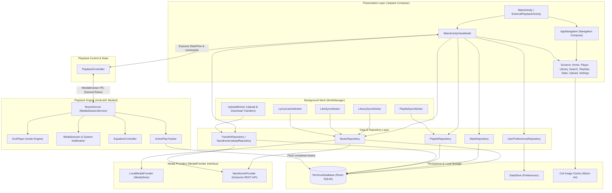

# Terminus System Architecture

This document describes the high-level architecture, layer responsibilities, and data flows of the **Terminus** Android music application.

---

## 1. Architectural Overview

Terminus is built with modern Android architectural best practices:
- **Clean Architecture & Separation of Concerns**: Isolates UI, playback services, data providers, and persistence.
- **Unidirectional Data Flow (UDF)**: UI observes reactive state (`StateFlow`) and emits explicit user intents or actions.
- **Provider Abstraction**: Decouples the application from concrete storage backends via the `MediaProvider` interface, supporting both local device media (`LocalMediaProvider`) and remote Subsonic/Navidrome servers (`NavidromeProvider`).
- **Foreground Media Service**: Offloads audio decoding, audio focus, notification management, and media session synchronization to a dedicated AndroidX Media3 `MediaSessionService`.

---

## 2. Core Layers & Responsibilities

### Presentation Layer (`ui`)
- **Technology**: Jetpack Compose, Jetpack Navigation Compose, Material 3 + Custom HUD/CRT Design System.
- **Key Components**:
  - `MainActivity`: Single-activity container hosting the Compose UI tree and system bar configuration.
  - `ExternalPlaybackActivity`: Lightweight endpoint to handle external `ACTION_VIEW` audio intents.
  - `MainActivityViewModel`: Collects repositories, combines audio playback status, and exposes immutable UI state to composables.
  - `screens/`: Feature-scoped screen composables (`HomeScreen`, `NowPlayingScreen`, `LibraryScreen`, `SearchScreen`, `StatsScreen`, `UploadScreen`, `SettingsScreen`, etc.).

### Playback Layer (`playback`)
- **Technology**: AndroidX Media3 (ExoPlayer), Android MediaSession, AudioFocus.
- **Key Components**:
  - `MusicService`: Runs as a bound/foreground `MediaSessionService`. Manages the `ExoPlayer` instance, media notifications, lockscreen playback controls, audio focus loss/ducking, and crossfading.
  - `PlaybackController`: Singleton controller injected into UI ViewModels. Communicates with `MusicService` via AndroidX `MediaController` across process/thread boundaries. Exposes observable `nowPlaying: StateFlow<NowPlayingState>`.
  - `ActivePlayTracker`: Granular listening session timer that tracks elapsed milliseconds and flushes play events to `StatsRepository` when qualification thresholds are met.
  - `EqualizerController`: Direct interface with system audio session bands and gains.

### Data & Provider Layer (`data`)
- **Key Components**:
  - `MediaProvider`: Unified contract defining operations for loading tracks, albums, artists, playlists, search, and streaming URLs.
  - `LocalMediaProvider`: Queries Android's system `MediaStore` for local audio files.
  - `NavidromeProvider`: Communicates with a personal Navidrome server using the Subsonic API standard (REST/XML/JSON), parsing remote metadata, search results, and stream tokens.
  - `MusicRepository`: Facade consolidating data from all active providers and local Room cache.
  - `UserPreferencesRepository`: Backed by AndroidX DataStore for user settings (motion modes, crossfade duration, equalizer presets, Navidrome server credentials).

### Background Execution (`sync`)
- **Technology**: AndroidX WorkManager, Foreground Services.
- **Key Components**:
  - `LibrarySyncWorker`: Performs periodic or on-demand catalog synchronizations with configured providers.
  - `UploadWorker`: Handles queue-based bi-directional file transfers (uploading local audio to Navidrome, downloading server streams for offline listening) with foreground notifications.
  - `LikeSyncWorker` & `PlaylistSyncWorker`: Syncs favorite tracks and playlist structures with remote servers.
  - `LyricsCacheWorker`: Fetches and caches synchronized LRC lyrics.

---

## 3. Related Architecture Documentation

- [Playback Lifecycle & Audio Focus](file:///home/amns/Projects/Terminus/docs/PLAYBACK_LIFECYCLE.md)
- [Sync, Transfers & Offline Engine](file:///home/amns/Projects/Terminus/docs/SYNC_AND_TRANSFERS.md)
- [Database Schema & Entity Relationships](file:///home/amns/Projects/Terminus/docs/DATABASE_SCHEMA.md)
