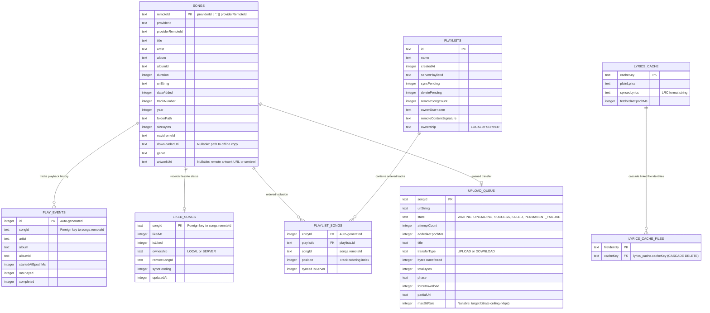

# Room Database Schema & Persistence

This document details the database architecture, entity relationships, schema definitions, and migration guidelines for **Terminus**.

---

## 1. Database Overview

Terminus uses **AndroidX Room** (SQLite) as its primary local store.
- **Database Class**: `TerminusDatabase`
- **Database File**: `terminus.db`
- **Current Version**: `25`
- **Location**: `app/src/main/java/com/necroware/terminusplayer/data/database/`

---

## 2. Entity-Relationship (ER) Diagram



---

## 3. Provider-Aware Identity Principle

A key architectural rule in Terminus is the strict separation between **database IDs** and **provider IDs**:

- Devices may aggregate music from local storage (`LOCAL`) and one or more Navidrome servers (`NAVIDROME`).
- Different providers can have conflicting local IDs (e.g., track ID `101` in MediaStore vs track ID `101` in Navidrome).
- To guarantee cross-provider uniqueness without collisions:
  $$\text{remoteId} = \text{providerId} \mathbin{\Vert} \text{":"} \mathbin{\Vert} \text{providerRemoteId}$$
- All foreign relationships (such as `liked_songs.songId`, `play_events.songId`, `playlist_songs.songId`) reference this composite `remoteId`.

---

## 4. Entity Specifications & Indexes

### `songs`
- **Primary Key**: `remoteId` (`TEXT`)
- **Indexes**:
  - `(providerId, providerRemoteId)` — `UNIQUE` (prevents duplicate catalog entries during scans)
  - `(artist)`
  - `(album)`
  - `(folderPath)`
  - `(genre)`

### `play_events`
- **Primary Key**: `id` (`INTEGER` auto-generated)
- **Granular Session Log**: One record per listening session. Used to generate all dynamic HUD charts (bar, line, scatter, box plot, activity heatmaps) without pre-aggregated rollup tables.
- **Indexes**:
  - `(startedAtEpochMs)`
  - `(songId)`

### `playlist_songs`
- **Primary Key**: `entryId` (`INTEGER` auto-generated)
- **Composite-Keyed Join Table**: Preserves track order explicitly via the `position` column.
- **Index**:
  - `(playlistId, position)`

---

## 5. Migration Rules & History

When modifying the database schema in Terminus:
1. **Never use `fallbackToDestructiveMigration()` in production**: Terminus stores offline user likes, play history, custom playlists, and download queues. Destructive migrations would wipe user data.
2. **Always write an explicit `Migration(from, to)`**: Test data survival across version jumps.
3. **Chunk Bulk Operations**: SQLite on Android has parameter binding limits (999 or 32766 depending on API version). Large inserts or `WHERE IN (...)` updates must be batched.

### Recent Migrations

#### `MIGRATION_23_24` (v23 $\to$ v24)
- **Goal**: Add remote album artwork support for cloud streaming providers (YouTube Music, Jamendo) and cached server sentinel URIs.
- **DDL Execution**:
  ```sql
  ALTER TABLE songs ADD COLUMN artworkUri TEXT DEFAULT NULL
  ```
- **Integrity Guarantee**: Existing local MediaStore songs and Navidrome catalog tracks default to `NULL`, falling back to embedded art extraction or server cover art proxies without data loss.

#### `MIGRATION_24_25` (v24 $\to$ v25)
- **Goal**: Enable per-job download bitrate ceilings on queued transfer jobs.
- **DDL Execution**:
  ```sql
  ALTER TABLE upload_queue ADD COLUMN maxBitRate INTEGER DEFAULT NULL
  ```
- **Integrity Guarantee**: In-flight and waiting transfers preserve their state; `maxBitRate` defaults to `NULL` (meaning unlimited/original quality) for pre-existing queue entries.

---

## 6. Remote Track Persistence & Deletion Protection

Terminus supports on-demand remote tracks from providers that are not fully scanned into the library during periodic sync:
- **YouTube Music** (`providerId = "youtube"`) and **Jamendo** (`providerId = "jamendo"`).
- When a user interacts with a remote track (plays, likes, adds to playlist, or downloads), `MusicRepository.ensureTrackPersisted()` or `ensureTracksPersisted()` inserts the track into the `songs` table with its canonical `remoteId`.
- **Sync Deletion Protection**: Inside [MusicRepository.syncLibrary()](file:///home/amns/Projects/Terminus/app/src/main/java/com/necroware/terminusplayer/data/repository/MusicRepository.kt), the catalog reconciliation query specifically excludes these providers:
  ```kotlin
  val currentToDelete = currentSongs.values
      .filter { it.providerId != "jamendo" && it.providerId != "youtube" && it.providerId !in failedProviders && it.remoteId !in scannedIds }
      .map { it.remoteId }
  ```
  This ensures that full-library synchronization of local files or Navidrome servers never purges persisted YouTube or Jamendo favorites, playlist members, or offline downloads.
