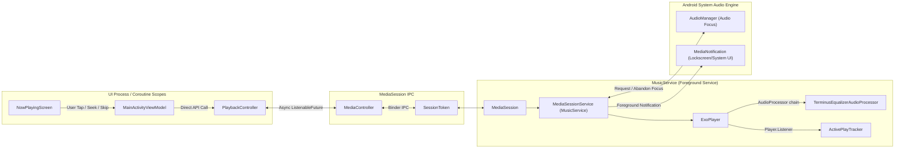
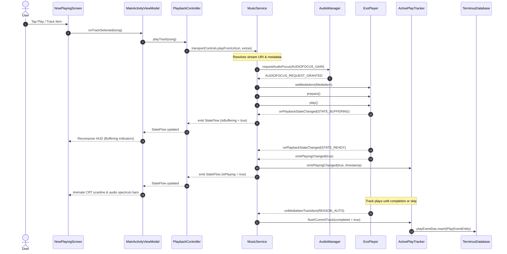
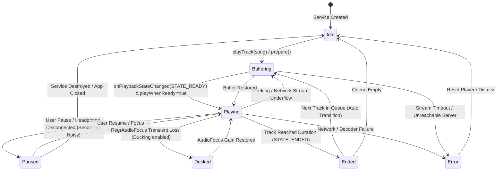

# Playback Lifecycle & Audio Focus

This document details the audio playback pipeline, media session integration, audio focus transitions, and listening statistics tracking in **Terminus**.

---

## 1. Playback Architecture & Components

Terminus uses **AndroidX Media3** for audio playback. The architecture is split between UI-facing controllers and a standalone background service.

---

## 2. Playback Sequence: Starting a Track

When a user taps a song or a playlist item, the request flows through the following asynchronous steps:

### Queue Startup Fast-Path & Prioritized Resolution

To ensure sub-300ms startup times when launching large queues (e.g. 1,000+ songs) without blocking the UI or delaying audio output:
1. **Immediate Playback Fast-Path**: [PlaybackController](file:///home/amns/Projects/Terminus/app/src/main/java/com/necroware/terminusplayer/playback/PlaybackController.kt) resolves the target URI for the selected track (`boundedStartIndex`), installs it as a single-item queue via `activeController.setMediaItem(targetItem, 0L)`, and starts playback immediately.
2. **Persistence Guarantee**: Any remote tracks in the active queue (`youtube`, `jamendo`) are ensured to be persisted in Room via `MusicRepository.ensureTracksPersisted()` so likes, lyrics, and playlists function properly.
3. **Distance-Prioritized Resolution**: Surrounding tracks are prioritized by distance from the active track index (`kotlin.math.abs(index - boundedStartIndex)`), resolved in the background off the main thread, and assembled into the live player via `activeController.addMediaItems(0, itemsBefore)` and `activeController.addMediaItems(itemsAfter)` without interrupting audio.
4. **Queue Order Integrity**: The final player playlist strictly matches the original requested order `[items[0] .. targetItem .. items[last]]`.

### Stream Quality Switching

When cellular transport status changes or the user adjusts bitrate preferences in Settings:
- `MusicService` observes `UserPreferencesRepository.serverConnectionConfig`.
- If the effective bitrate changes, `refreshQueueForStreamQuality()` re-resolves stream URLs for remote items (`navidrome`, `youtube`, `jamendo`).
- For Navidrome, time-offset streaming URLs preserve playback position; for direct HTTP streams, ExoPlayer re-prepares with the new stream URL while retaining the exact playback position (`snapshot.currentPositionMs`).

### Artwork Precedence Rules

Artwork resolution across UI components ([NowPlayingScreen](file:///home/amns/Projects/Terminus/app/src/main/java/com/necroware/terminusplayer/ui/screens/nowplaying/NowPlayingScreen.kt), [MiniPlayerBar](file:///home/amns/Projects/Terminus/app/src/main/java/com/necroware/terminusplayer/ui/components/MiniPlayerBar.kt), [AdaptiveArtAccent](file:///home/amns/Projects/Terminus/app/src/main/java/com/necroware/terminusplayer/ui/theme/AdaptiveArtAccent.kt)) respects the following precedence:
1. `pendingSong.artworkUri` (during active track transitions)
2. `nowPlaying.artworkUri` (remote image URL from YouTube or Jamendo)
3. `currentSongUri` (local audio `content://` URI containing embedded artwork)
4. Navidrome cover art sentinel: `terminus://<songId>` $\to$ `https://terminus.invalid/rest/getCoverArt?id=...` (authenticated with Subsonic token via `NetworkModule`)
5. Non-image audio/web URLs (such as `https://www.youtube.com/watch?v=...`) are filtered out to prevent Coil from attempting to decode HTML web pages as bitmaps.

---

## 3. Playback State Machine

The audio engine transitions across ExoPlayer lifecycle states, handling user commands and audio focus interrupts gracefully:

---

## 4. Audio Focus Policy

`MusicService` monitors system audio focus changes via `AudioManager`:

| Focus Event | Behavior |
| :--- | :--- |
| **`AUDIOFOCUS_GAIN`** | Resumes playback or restores volume to 100% if previously ducked. |
| **`AUDIOFOCUS_LOSS_TRANSIENT`** | Pauses playback temporarily (e.g., incoming phone call, turn-by-turn navigation). Resumes automatically when focus returns. |
| **`AUDIOFOCUS_LOSS_TRANSIENT_CAN_DUCK`** | Lowers playback volume (ducks) temporarily without pausing. |
| **`AUDIOFOCUS_LOSS`** | Permanent focus loss (another music app started). Pauses playback and abandons audio focus. |
| **`ACTION_AUDIO_BECOMING_NOISY`** | Headphones or Bluetooth unplugged/disconnected. Instantly pauses playback to prevent unwanted loud audio output. |

---

## 5. Active Play Tracking & Statistics

To populate the listening statistics screens (`StatsScreen`):
1. **Granular Listening Time**: `ActivePlayTracker` measures actual milliseconds spent playing, subtracting pause and buffering times.
2. **Qualification Threshold**: An event is marked `completed = true` when played past 50% of track duration (or 30 seconds for long audio).
3. **Database Insertion**: On track transition or playback stop, `MusicService` asynchronously writes a `PlayEventEntity` into `TerminusDatabase` via `StatsRepository` on `Dispatchers.IO`.
