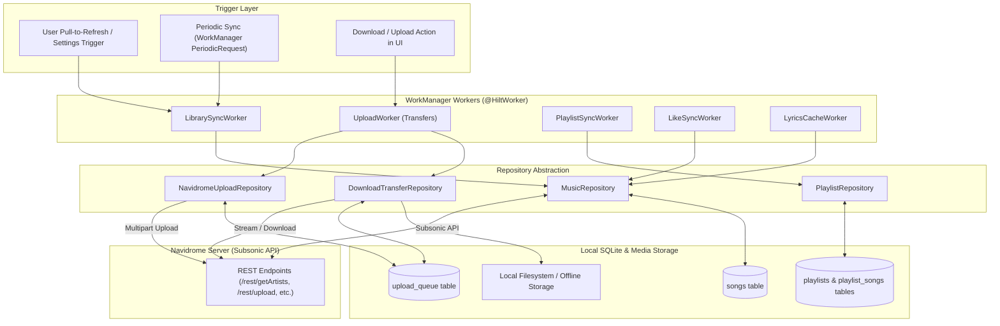
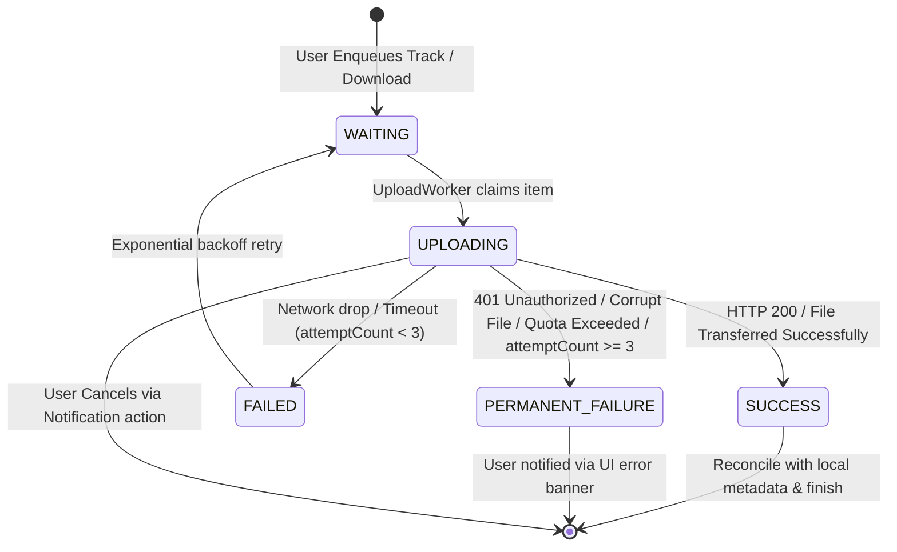
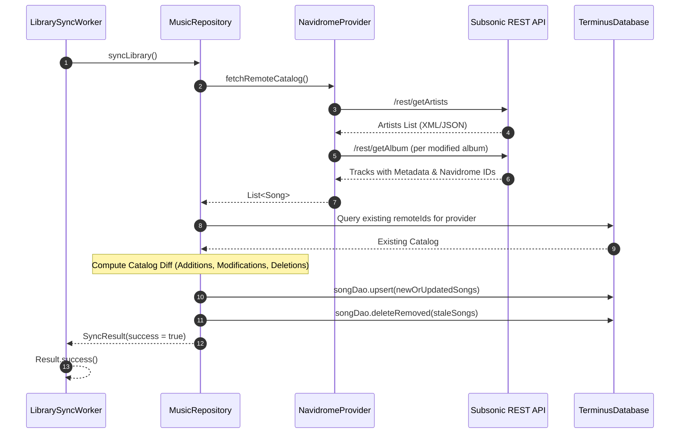

# Sync, Transfers & Offline Engine

This document details the synchronization mechanics, WorkManager background jobs, transfer pipeline (uploads and downloads), and offline caching in **Terminus**.

---

## 1. Sync Architecture Overview

Terminus integrates with personal Navidrome servers using the Subsonic API standard. Because mobile network connectivity can be intermittent, all synchronization and file transfer operations are managed through **AndroidX WorkManager** and local persistence in Room.

---

## 2. Transfer Pipeline: Uploads and Offline Downloads

The `UploadWorker` is a unified transfer engine responsible for both:
1. **Uploading local audio tracks** to the Navidrome server.
2. **Downloading remote tracks** for offline playback on the device.

### Transfer State Machine

The state of every transfer is tracked in the `upload_queue` table:

### Foreground Notification & Cancellation

To prevent Android from killing transfer jobs while large music files are being transmitted in the background:
- `UploadWorker` promotes itself to an Android Foreground Service using `setForeground(ForegroundInfo(...))`.
- An active notification displays bytes transferred, total size, percentage progress, and a **Cancel** action intent.
- `CancelUploadNotificationReceiver` listens for user cancellation taps, cancels the active coroutine job, and resets queue state.

### Download Lifecycle & Quality Ceilings

The download subsystem is orchestrated via [DownloadTransferRepository](file:///home/amns/Projects/Terminus/app/src/main/java/com/necroware/terminusplayer/data/repository/DownloadTransferRepository.kt) and implemented in [MusicRepository.downloadSong()](file:///home/amns/Projects/Terminus/app/src/main/java/com/necroware/terminusplayer/data/repository/MusicRepository.kt):

1. **Queue Creation & Per-Job Settings**:
   - When downloads are enqueued via `UploadQueueManager.enqueueDownloads()`, the user's active `downloadMaxBitRate` preference is captured and persisted directly in `upload_queue.maxBitRate`.
   - Existing queued jobs preserve their configured bitrate ceiling; changing the setting in the UI later does not retroactively change or corrupt pending jobs.
2. **Provider-Specific Bitrate Handling**:
   - **Navidrome**: If `maxBitRate` is specified, `subsonicApi.stream(maxBitRate = ..., targetFormat = "mp3")` is called. If transcoding fails or is unsupported on the server (`DownloadFormatUtils.isTranscodingFailure()`), the worker automatically falls back to downloading the original stream via `subsonicApi.download()`.
   - **YouTube Music**: `YouTubeStreamResolver.selectAudioFormat()` selects the adaptive audio format meeting the bitrate ceiling (or the lowest available if all exceed it). If HTTP 403 or 410 is encountered due to token expiration, the resolver cache is invalidated, and a fresh stream URL is fetched and retried once before reporting an error.
3. **Format & Extension Verification ([DownloadFormatUtils](file:///home/amns/Projects/Terminus/app/src/main/java/com/necroware/terminusplayer/util/DownloadFormatUtils.kt))**:
   - File extensions and MIME types are derived from actual server response headers (`Content-Type` and `Content-Disposition`) rather than assumed from requested formats.
   - Files are stored with their true container extension (`.flac`, `.m4a`, `.webm`, `.opus`, `.mp3`).
4. **Atomic Commit & MediaStore Publishing**:
   - Initial output stream writes to a file with `MediaStore.Audio.Media.IS_PENDING = 1` or an uncommitted document in the custom SAF download folder.
   - On byte stream completion, `destination.publish()` sets `IS_PENDING = 0`, commits the file, and links `songDao.setDownloadedUri(songId, uri)`.
   - If a previous download existed under a different format/URI, `cleanupInterruptedDownload(previousDownloadedUri)` safely removes the stale file.
   - On cancellation or failure, `destination.delete()` is called immediately to prevent corrupted partial files from remaining on disk.
   - Warmup is scheduled via `scheduleLyricsWarmup(songId)` to pre-cache synchronized lyrics for offline use.

---

## 3. Library Synchronization Flow (`LibrarySyncWorker`)

---

## 4. Conflict Resolution Strategy

### Liked Songs (`LikeSyncWorker`)
- **Local Star Wins**: If a track is liked locally while offline, its `syncPending = true` flag persists. On reconnect, the star is synced to the server.
- **Server Updates**: Server stars are merged into `liked_songs`. If there is a dispute, latest `updatedAt` timestamp determines priority.

### Playlists (`PlaylistSyncWorker`)
- **Server Signature Checking**: Every playlist sync computes a `remoteContentSignature` based on track IDs and order.
- **Conflict Flagging**: If a playlist was modified both locally and on the server simultaneously, `conflictRemoteSignature` and `conflictRemoteSongIds` are recorded, and the UI presents a conflict resolution prompt rather than destructively overwriting user playlists.
